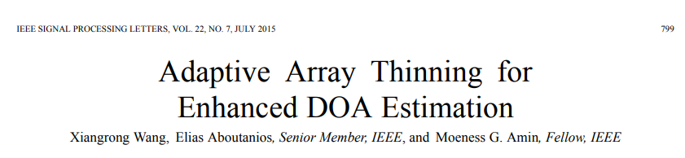
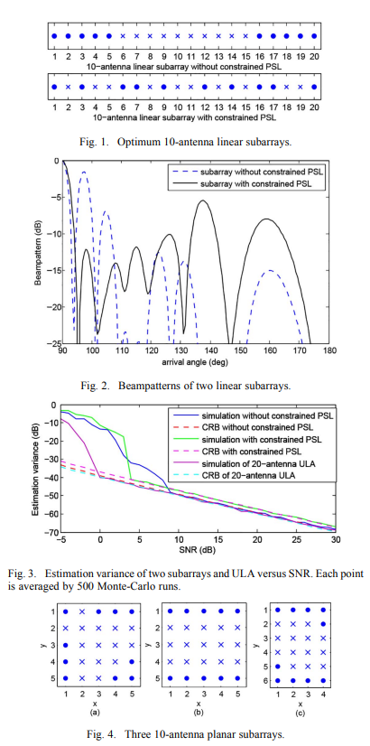
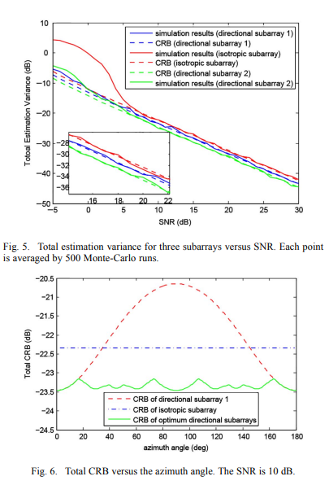

# DOA Estimation Adaptive Array Sparse Technique for Improving Performance of Direction of Arrival Estimation [with MATLAB Code]

Abstract: The array configuration of antennas plays a crucial role in direction of arrival (DOA) estimation. This paper proposes an antenna selection strategy to enhance the performance of DOA estimation through the reconstruction of multi-antenna receivers. For single signal source scenarios, peak sidelobe level (PSL) constraints are derived for both isotropic and directional arrays, with the Cramér-Rao bound (CRB) presented in the form of parameters selected for the antennas and corresponding subarrays. Due to the angle-dependent nature of directional arrays, this paper introduces the Dinklebach algorithm and convex relaxation techniques, combined with semidefinite programming, to adaptively reconstruct directional subarrays, ensuring optimal antenna selection. Simulation results validate the effectiveness of the proposed antenna selection strategy.
Keywords: Antenna Selection; Cramér-Rao Bound; Dinklebach Algorithm; Directional Array; Isotropic Array
Introduction: The use of antenna arrays to estimate direction of arrival (DOA) is an important research direction in the field of signal processing, with wide applications across various domains. The accuracy of DOA estimation not only depends on the algorithms used but also closely relates to the array configuration at the receiving end. Currently, numerous studies have focused on the impact of array configuration on DOA estimation performance, covering both near-field [1,2] and far-field [3] scenarios. The Cramér-Rao bound (CRB), as a common metric for evaluating estimation performance, is often used to analyze the impact of array configuration on estimation accuracy [4].
Existing research has derived compact expressions for the CRB in both two-dimensional and three-dimensional isotropic arrays under antenna position parameters [5-8]; Bayesian CRB methods have been proposed for single signal sources with known prior probability distributions [9]; studies on the CRB of two-dimensional arrays have found that the optimal array is V-shaped when the element spacing is equal and the array geometry is assumed to be concave [10-12]. Additionally, optimal directional array design methods have been introduced, but these studies only consider ideal signal incidence directions and their exhaustive search strategies are limited in practicality.
Beyond the cost calculation, the hardware costs of large arrays are also unbearable —— each antenna requires an independent receiver, a significant restriction on the application of large arrays. Therefore, this paper aims to maximize direction-of-arrival (DOA) estimation performance by adjusting the array geometry while reducing the number of antennas (i.e., lowering hardware and computational costs). To achieve the reconfigurability of the array, we perform sparse processing on the complete array through controlling a series of radio frequency (RF) switches.
Document [13] has studied the sensor selection problem under uniform linear array (ULA) scenarios to meet the target CRB requirements with the minimum number of antennas. However, this paper extends the antenna selection method to any geometric shape arrays (including isotropic and directional arrays), achieving CRB minimization under fixed antenna count. Since the non-uniform distribution of selected antennas often leads to high sidelobes, this paper balances the trade-off between peak sidelobe suppression and estimation accuracy using spatial correlation coefficient (SCC).
In radar and satellite communication fields, the working environment is usually dynamically changing, requiring the system to have adaptive capabilities for interference localization so that interference can be mitigated later. It is known that antenna selection essentially falls into the NP-hard combinatorial optimization problem: for isotropic subarrays constrained by peak sidelobe level (PSL), an exhaustive search can find the optimal solution; whereas directional subarrays have angle dependence and require polynomial time selection algorithms to achieve the array's adaptive sparseness. Therefore, this paper combines semidefinite programming with efficient Ditzenbeck-type algorithms and convex relaxation techniques to solve the antenna selection problem.
The subsequent content of this paper is arranged as follows: Section 2 derives the mathematical model; Section 3 and Section 4 respectively introduce the optimal selection methods for isotropic subarrays constrained by PSL and directional subarrays; Section 5 presents simulation results; and Section 6 concludes the paper.
Conclusion: This paper proposes an array sparsification strategy to enhance the performance of direction-of-arrival (DOA) estimation. For isotropic arrays and directional arrays, models based on the Cramér-Rao bound (CRB) are constructed for antenna selection problems, along with corresponding solution methods. To address the combinatorial optimization problem, this paper introduces the Dinglebach algorithm and convex relaxation technique, achieving efficient solutions within polynomial time.
In scenarios with multiple signal sources, the isotropic array under peak sidelobe level (PSL) constraint has universality and can be used as an initial array to obtain prior information about the signal sources. Subsequently, for each estimated signal source, an optimal directional subarray can be reconstructed to further enhance the DOA estimation performance.

## Images

<!-- PAYMENT_BLOCK -->

## Get this dataset

- Payment link (Stripe): [Buy now](https://buy.stripe.com/3cs8yP7sY87d0vu9AB)
- Payment QR code: 

<!-- /PAYMENT_BLOCK -->
